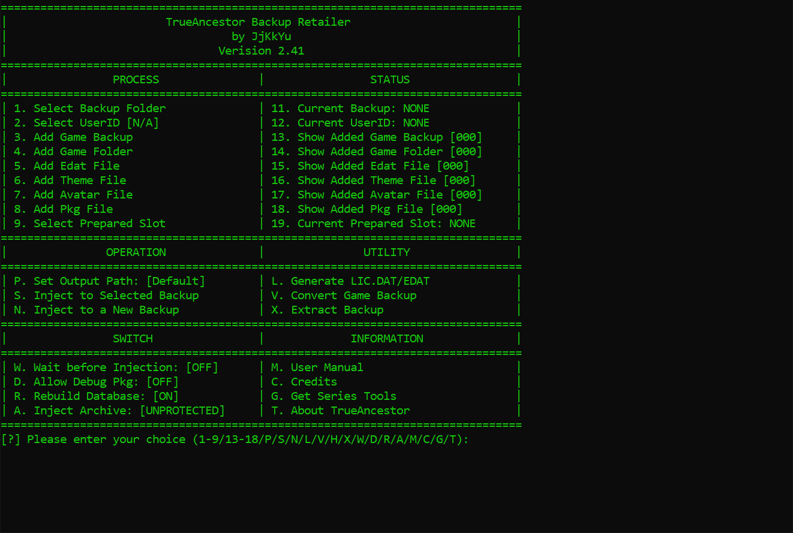

# TrueAncestor BACKUP Retailer v2.41

**TrueAncestor BACKUP Retailer** est un utilitaire Windows pour **PlayStation 3**, créé par **JjKkYu**. Il permet d’extraire et de modifier les sauvegardes système de la console, d’y intégrer des contenus compatibles et de préparer de nouveaux backups.

**Version :** 2.41  
**Plateforme :** PS3  
**Système :** Windows  
**Développeur original :** JjKkYu

## Fonctionnalités

- Extraction du contenu des sauvegardes système PS3.
- Injection de dossiers de jeux, de packages `PKG`, de thèmes, d’avatars et de fichiers `EDAT` pris en charge.
- Préparation de nouveaux backups contenant les éléments sélectionnés.
- Conversion des backups de jeux compatibles.
- Choix du dossier de sortie pour les sauvegardes générées.
- Injection directe de fichiers préparés grâce à la fonction **Prepared Slot**, sans copie préalable dans le dossier de travail.

## Nouveautés de la version 2.41

- Correction d’un plantage fatal lors de l’ajout de backups de jeux.
- Mise à jour du manuel utilisateur.

## Utilisation

1. Téléchargez ce dépôt avec **Code → Download ZIP**, puis extrayez l’archive sur votre PC Windows.
2. Conservez une copie de votre sauvegarde système originale avant toute modification.
3. Lancez `TrueAncestor_BACKUP_Retailer_v2.41.exe` depuis le dossier extrait, puis sélectionnez le backup à traiter ou l’opération souhaitée.
4. Choisissez les contenus et le dossier de sortie en suivant le manuel intégré, accessible avec **M — User Manual**.
5. Vérifiez le résultat avant toute restauration sur votre console.

## Contenu du dépôt

Le dépôt contient la distribution binaire Windows de la version 2.41 :

- `TrueAncestor_BACKUP_Retailer_v2.41.exe` : programme principal.
- `tool/` : les 16 outils, bibliothèques et fichiers auxiliaires fournis avec le programme.
- `prepared/Slot1/` à `prepared/Slot9/` : les neuf arborescences de préparation et leurs gabarits `dev_hdd0/mms/db.err`.
- `history.txt` : historique des versions fourni avec le programme.
- `TrueAncestor_BACKUP_Retailer_Preview.png` : aperçu du menu principal.
- Les dossiers de travail, dont `backup/PS3/EXPORT/`, `extracted/PS3/EXPORT/`, `game/`, `GAMES/`, `idps/` et `workspace/`, sont conservés avec des fichiers `.gitkeep`.

Conservez cette arborescence complète à côté de l’exécutable. Git ignore le contenu ajouté dans les dossiers de travail, notamment les sauvegardes, les fichiers IDPS et les fichiers générés. Les neuf gabarits `db.err` restent suivis. Les sources du logiciel ne sont pas incluses dans cette distribution.

## Aperçu

## Important

- La compatibilité dépend des contenus, du firmware et de la méthode de restauration utilisée.
- Certaines opérations sur les sections protégées nécessitent l’IDPS de la console concernée.
- Ce dépôt n’est **pas le projet officiel** du développeur original.

## Crédits et informations

- **Développeur original :** JjKkYu
- [Présentation du développeur sur PSX-Place](https://www.psx-place.com/threads/trueancestor-backup-retailer-v2-00.11687/)
- [Nouveautés des versions 2.40 et 2.41 sur PSX-Place](https://www.psx-place.com/threads/trueancestor-backup-retailer-v2-40.28399/)

Les droits sur le logiciel restent ceux de leurs détenteurs respectifs.

